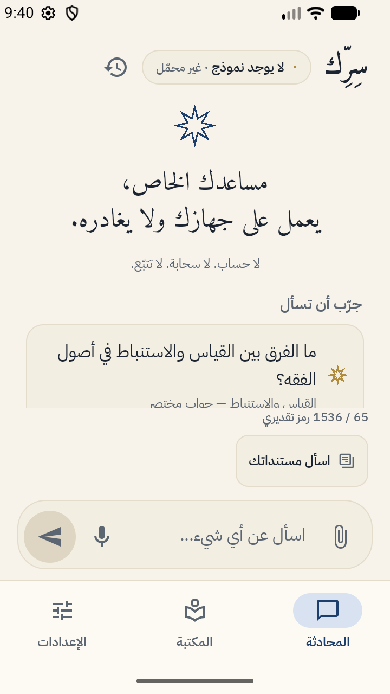
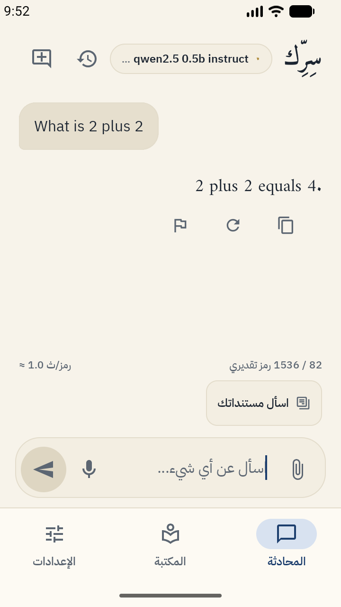
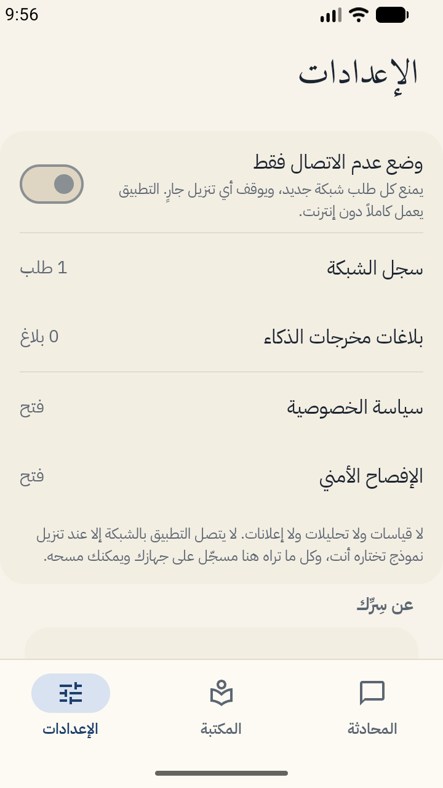
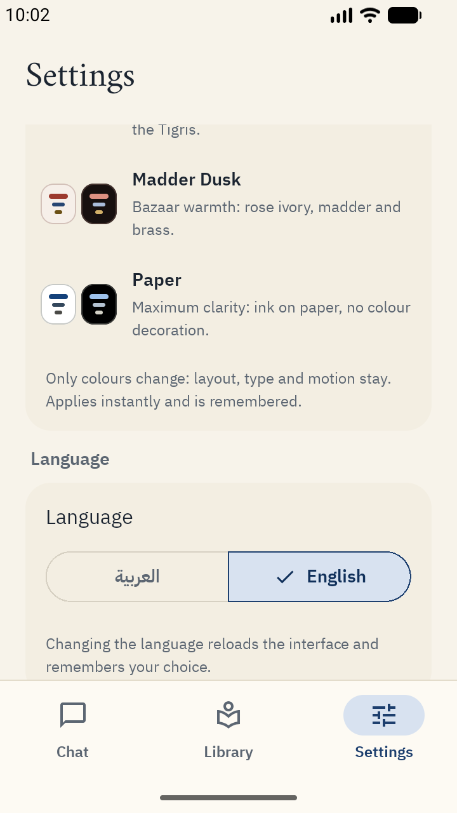

  

<h1 align="center">سِرِّك · Sirrak</h1>

  <strong>مساعد ذكاء اصطناعي عربي خاص يعمل على جهازك، لا على خادم.</strong> 
  محادثة وإملاء وإجابة من مستنداتك وإدارة نماذج — كلها دون اتصال.

  
  
  
  
  
  

  <a href="README.md">English</a> ·
  <b>العربية</b> ·
  <a href="https://alshahia.github.io/sirrak/ar/">الموقع</a> ·
  <a href="https://alshahia.github.io/sirrak/ar/privacy/">الخصوصية</a> ·
  <a href="https://alshahia.github.io/sirrak/ar/security/">الأمان</a> ·
  <a href="https://github.com/alshahia/sirrak/releases/latest">التنزيل</a> ·
  <a href="docs/README.md">الوثائق</a>

---

سِرِّك مساعد خاص بالعربية والإنجليزية يُشغّل نموذجًا لغويًا حقيقيًا على هاتفك. المحادثة والإملاء والإجابة من
المستندات وإدارة النماذج تعمل كلها دون اتصال؛ والطلب الشبكي الوحيد الذي يمكن أن يصدره التطبيق هو تنزيل نموذج
تبدأه أنت بنفسك. لا حسابات ولا سحابة ولا إعلانات ولا تتبّع ولا قياسات. المصدر مفتوح بترخيص Apache-2.0.

بُني سِرِّك عربيًا أولًا، لا مترجمًا لاحقًا: واجهة من اليمين إلى اليسار مصمَّمة من البداية، وخطّا أميري
وIBM Plex Sans Arabic، وإملاء عربي وإنجليزي، وخمس حزم ألوان مكتوبة يدويًا بدل لوحة Material الجاهزة.

**الحالة:** [المستودع](https://github.com/alshahia/sirrak) والموقع ثنائي اللغة عامّان، وسياسة الخصوصية
وسياسة الأمان منشورتان بالعربية والإنجليزية، وملف APK الموقَّع يُنزَّل من
[صفحة الإصدارات](https://github.com/alshahia/sirrak/releases/latest).
الإصدار الحالي مرشّح `1.0.0-rc2`، أما F-Droid وGoogle Play فمُهيَّآن ولا قائمة متجر لأيّ منهما بعد —
انظر قسم الحدود الصريحة أدناه.

## لماذا سِرِّك؟

- **على الجهاز أولًا.** المحادثة تعمل عبر محرّك [llama.cpp](https://github.com/ggml-org/llama.cpp) مبنيّ داخل
  التطبيق على المعالج، والمحادثات محفوظة في تخزين التطبيق الخاص.
- **دون اتصال حين تريد.** استورد ملف GGUF ولن يحتاج التطبيق الشبكة بعد ذلك. مفتاح **"دون اتصال فقط"**
  يمنع كل طلب ويوقف أي تنزيل جارٍ.
- **عربي أولًا.** واجهة RTL، وخطوط عربية، وإملاء عربي، واسترجاع عربي من المستندات — مُختبَر بـ24 حالة
  تقييم عربية تعمل مع كل اختبار JVM.
- **مصطلحات عربية موحّدة.** روجع المصطلح في مجلس قياس: «نموذج» لا «طراز»، و«تعليمات» لتعليمات المحادثة، و«ملحق الرؤية» للمُسقِط — [docs/30](docs/30-arabic-terminology.md).
- **تراخيص صادقة.** سجل تراخيص واعتمادات داخل التطبيق (23 مكوّنًا مع نصوص التراخيص كاملة دون اتصال) يغذّي
  "حول التطبيق" و[NOTICE](NOTICE) و[CycloneDX SBOM](sbom.cdx.json) المُختبَر ضدّ الانحراف؛ وكل نموذج في
  الكتالوج تُعرض رخصته قبل تنزيله.
- **صغير وقابل للفحص.** 15 وحدة Gradle، وخانات واجهة مُنمّطة (typed slots)، ونظام إضافات مرتَّب حسب
  الاعتماديات — الميزة وحدة واحدة وسطر واحد في بيان التركيب، لا نسخة من الواجهة.
- **لا حسابات ولا إعلانات ولا تتبّع ولا قياسات.** لا يوجد خادم تُرسل إليه شيئًا.

## ما الذي يفعله؟

| السطح | ما تحصل عليه |
|---|---|
| المحادثة | إجابات بثّية من نموذج GGUF محلي، ومحادثات متعددة مع بحث وإعادة تسمية وحذف، وعرض Markdown، وتعليمات نظام لكل محادثة مع تسلسلات إيقاف، ونسخ وإعادة توليد ومحادثة جديدة، وعدّاد رموز مع سرعة tok/s مقيسة |
| الإملاء | sherpa-onnx Whisper على الجهاز للعربية والإنجليزية مع مقياس مستوى صوت حي؛ يُلحق النص بمربع الكتابة ولا يُرسَل تلقائيًا؛ والصوت لا يغادر الجهاز |
| المستندات | استيراد PDF وDOCX وEPUB وMarkdown والنصوص، وفهرستها محليًا (تضمينات + BM25 عربي مدموجان بـRRF)، ثم السؤال مع الإجابة من مصادر مرقّمة غير موثوقة صراحةً، ومراجع قابلة للفتح |
| النماذج | كتالوج منسّق مع توصيات حسب جهازك (بما فيها فئة 2 غ.ب)، وتنزيلات قابلة للاستئناف ومتحقَّقة من بصمتها، وإيقاف/إلغاء/إعادة محاولة، وإشعار تقدّم في الخلفية، ومدير نماذج مثبتة ومساحة، واستيراد من Hugging Face |
| الإعدادات | الحرارة وtop-p وtop-k ومعاقبة التكرار وحجم السياق والبثّ واختيار قالب المحادثة والتعليمات العامة ولكل نموذج — كلها قابلة للإثبات في سطر سجل واحد |
| الألوان | خمس حزم كتبت يدويًا مع معاينة حية وبوابة تباين WCAG: گِريه والحبر، ليل اللازورد، فجر الفيروز، غروب الفوة، ورق |
| الخصوصية | سجل شبكة لكل طلب، ومفتاح "دون اتصال فقط"، وبلاغات محلية لمخرجات الذكاء الاصطناعي تصدّرها أنت فقط إن أردت، وحالة صريحة بدل رابط ميت حين لا توجد قائمة متجر بعد |

## التثبيت

1. افتح صفحة [الإصدارات](https://github.com/alshahia/sirrak/releases/latest) ونزّل ملف APK الموقَّع من
   نسخة **libre** (نحو 139 MiB، شامل arm64-v8a وx86_64). صفحة الإصدارات هذه هي مسار التنزيل الوحيد؛
   أما نسخة Play فهي حزمة موقَّعة منفصلة لم يبدأ اختبارها المغلق بعد.
2. ثبّته على **أندرويد 9 أو أحدث (API 28)**. قد يطلب أندرويد السماح بالتثبيت من هذا المصدر؛ الملف موقَّع
   بشهادة المشروع (SHA-256: <code>4537ECEB9952AC9020EFFCEB8B50CB10AEB795772792D632CFC3D0B9F7106806</code>،
   تحقّق بـ<code>apksigner verify --print-certs</code>).
3. من أول تشغيل، اختر نموذجًا في شاشة الترحيب، أو ابدأ بمحرّك العرض المدمج لتجربة الواجهة دون نموذج.
4. لا يوجد نموذج مضمَّن في التطبيق: نزّل واحدًا من الكتالوج المنسّق أو استورد ملف GGUF. بعد ذلك فعّل
   **"دون اتصال فقط"** فلن يستطيع التطبيق الوصول إلى الشبكة إطلاقًا.

**F-Droid:** الوصفة جاهزة، لكن الإرسال غير مفتوح: ما زال وقت تشغيل sherpa-onnx المضمَّن مسبقًا يحتاج
بناءً من المصدر في وصفة F-Droid (متابَع في [docs/27](docs/27-sirrak-launch-checklist.md)).
**Google Play:** الحزمة الموقَّعة مبنية ومتحقَّق منها؛ لم يبدأ الاختبار المغلق بعد، فلا قائمة Play حتى الآن.

## لقطات الشاشة

  
  
  
  

واجهة عربية أولًا، فاتحة وداكنة، خمس حزم، وأهداف لمس 48 dp ودعم نص حتى 200%.

## الخصوصية بالتصميم

- **لا تتبّع ولا قياسات ولا إعلانات ولا خدمة تقارير أعطال.** لا يُرسَل شيء إلى أي مكان إلا إذا بدأت أنت
  تنزيل نموذج.
- **سجل شبكة لا يمكن إخفاؤه.** يعلن التطبيق كل نقطة اتصال في الإعدادات ويسجّل الطلبات التي حدثت فعلًا على
  الجهاز؛ والسجل لا يغادر الهاتف.
- **وضع "دون اتصال فقط" يُفرَض قبل فتح أي مقبس**، وليس تلميحًا في الواجهة.
- **المستندات والمحادثات والنماذج والإعدادات تبقى في تخزين التطبيق الخاص.** ولا يحدث تصدير إلا عبر منتقي
  أندرويد الذي تستدعيه بنفسك.
- **السياسات (منشورة، بالعربية والإنجليزية):** [الخصوصية](https://alshahia.github.io/sirrak/ar/privacy/)
  و[الأمان](https://alshahia.github.io/sirrak/ar/security/)، وموجودتان في المستودع أيضًا في
  [PRIVACY.md](PRIVACY.md) و[SECURITY.md](SECURITY.md).

## البناء من المصدر

المتطلبات: JDK 21، وأندرويد SDK منصة 36 وأدوات بناء 36، وNDK **27.2.12479018** وCMake 3.22.1 للمحرّك
الأصلي، وGradle wrapper 8.10.2 (مضمَّن). شيفرة llama.cpp مضمَّنة في <code>third_party/llama.cpp</code> فلا
يحتاج البناء الأصلي إلى الشبكة.

~~~powershell
# اضبط هذه المتغيّرات على مساري JDK 21 وAndroid SDK عندك
$env:JAVA_HOME = '<path-to-jdk-21>'
$env:ANDROID_HOME = '<path-to-android-sdk>'
$env:ANDROID_SDK_ROOT = $env:ANDROID_HOME

# نسخة debug من صنف libre (الافتراضي لـF-Droid والاستضافة الذاتية؛ play هو صنف المتجر)
.\gradlew :app:assembleLibreDebug

# 567 اختبار JVM (نفس المجموعة التي يشغّلها CI)
.\gradlew :app:testLibreDebugUnitTest testDebugUnitTest

# APK إصدار موقَّع + حزمة Play (يقرأ keystore.properties غير المُلتزم به؛ بدون المفتاح يخرج غير موقَّع)
.\gradlew assembleLibreRelease bundlePlayRelease

# بوابات الجودة
.\gradlew :app:lintLibreDebug
pwsh -File scripts/ui-regression.ps1     # انحدار لقطات الشاشة مقابل الأساسيات المُلتزم بها
pwsh -File scripts/validate-store.ps1    # 79 فحصًا: حدود النصوص، بصمات الرسوميات، وثائق الإطلاق
pwsh -File scripts/release-check.ps1     # بناء + توقيع + أصول المتجر + لقطات -> build/release-check.json
~~~

التفاصيل في [CONTRIBUTING.md](CONTRIBUTING.md) و[docs/05-architecture.md](docs/05-architecture.md)
و[docs/07-test-environment-emulator.md](docs/07-test-environment-emulator.md).

## البنية والتوسعة دون ترميز ثابت

- **الميزات** وحدات Gradle يركّبها [AppComposition.kt](app/src/main/java/app/sirrak/AppComposition.kt)،
  ويأتي ترتيبها وتفعيلها من <code>app/src/main/assets/config/app.json</code> دون إعادة بناء.
- **واجهة ما بين الميزات** تمرّ عبر خانات مُنمّطة في [Slots.kt](core/runtime/src/main/java/app/sirrak/core/runtime/Slots.kt)؛
  ولا تستورد ميزةٌ ميزةً أخرى.
- **حزم الألوان** كائن بيانات واحد لكل حزمة في [ThemePacks.kt](core/design/src/main/java/app/sirrak/core/design/ThemePacks.kt)،
  وبوابة التباين تعيد فحص كل حزمة.
- **النصوص** في ملفات الموارد، و**النماذج والتعليمات والمحتوى التجريبي** أصول JSON، و**رسوميات المتجر**
  تُولَّد من [brand.json](store/graphics/brand.json)، و**الموقع** يُولَّد من [website/site.json](website/site.json).
- **التراخيص** سطر واحد في سجل واحد: "حول التطبيق" وNOTICE وSBOM كلها مشتقّة منه، واختبارات الانحراف تفشل
  البناء إذا اختلفت.

القواعد مكتوبة في [CONTRIBUTING.md](CONTRIBUTING.md) و[docs/17-customization-council.md](docs/17-customization-council.md).

## الجودة والأدلة

| البوابة | النتيجة على <code>1.0.0-rc2</code> |
|---|---|
| اختبارات وحدة JVM | **567 اختبارًا، 0 فشل** في 9 وحدات |
| التقييم العربي | **24/24** حالة (تطبيع، تقسيم جمل، BM25، ضوابط سلبية) |
| Android lint | **0 أخطاء** و36 تحذيرًا مُراجَعًا (تثبيت إصدارات الاعتماديات وAGP، إضافة إلى 3 تحذيرات TLS عابرة) |
| انحدار لقطات الشاشة | **4/4 شاشات، مسافة 0** مقابل الأساسيات المُلتزم بها |
| مدقق المتجر | **79/79 فحصًا** (حدود النصوص، بصمات الرسوميات، وثائق الإطلاق) |
| بوابة الإصدار | [<code>scripts/release-check.ps1</code>](scripts/release-check.ps1) يبني ويتحقّق من توقيع v2 والشهادة ويفحص حزمة AAB وأصول المتجر ولقطات الشاشة |
| SBOM | CycloneDX 1.5، 22 مكوّنًا، مولَّد من سجل التراخيص ومُختبَر ضدّ الانحراف |
| إمكانية الوصول | أهداف 48 dp، نص 200%، انعكاس RTL، تسميات TalkBack، بوابة تباين WCAG |

## حدود صريحة

- **الأداء** مقيس على محاكٍ (API 36 x86_64) لا على هاتف حقيقي؛ نسخ arm64 متوفرة لكن غير مقيسة هنا.
- ملف APK **شامل** (arm64-v8a + x86_64 بنحو 139 MiB) بلا تقسيم ABI حتى الآن، والتوقيع **v2 فقط**
  (تدوير المفاتيح v3/v4 غير مُهيأ).
- **جودة النماذج تتفاوت.** لا يضم الكتالوج نموذج رؤية ثنائي اللغة؛ والأسئلة البصرية بالعربية حدّ معروف.
  والنماذج الصغيرة قد تتجاهل المراجع، وهناك احتياطي حتمي يغطي ذلك.
- **F-Droid غير منشور** — يحتاج AAR المضمَّن لـsherpa-onnx إلى بناء من المصدر أولًا. و**Play غير منشور** —
  لم يبدأ الاختبار المغلق.
- صفحات السياسات منشورة بالعربية والإنجليزية، لكن لا توجد قائمة متجر بعد، لذا يُظهر التطبيق حالة صريحة
  حيث ينقص رابط المتجر.
- CI يشغّل اختبارات JVM والتقييم العربي وlint؛ أما اختبارات الجهاز وانحدار اللقطات وبناء الإصدار فمحلية
  (تحتاج محاكيًا أو مفاتيح توقيع) — انظر [docs/27](docs/27-sirrak-launch-checklist.md).

## الوثائق

- [docs/README.md](docs/README.md) — فهرس كل سجلات البناء العامة.
- [docs/26-sirrak-p3-polish-launch.md](docs/26-sirrak-p3-polish-launch.md) — سجل مرشح الإطلاق.
- [docs/27-sirrak-launch-checklist.md](docs/27-sirrak-launch-checklist.md) — ما أُنجز وما بقي.
- [docs/28-public-launch-council.md](docs/28-public-launch-council.md) — قرارات مجلس الإطلاق العام والموقع وSEO.
- [DESIGN.md](DESIGN.md) — نظام تصميم گِريه والحبر.
- [PRODUCT.md](PRODUCT.md) — نطاق المنتج ووعوده.

## الترخيص والاعتمادات والأمان

سِرِّك مرخَّص بموجب [رخصة أباتشي 2.0](LICENSE). المكوّنات والخطوط والنماذج الخارجية مذكورة في
[NOTICE](NOTICE)، ونصوص التراخيص الكاملة مضمَّنة داخل التطبيق. أوزان النماذج غير مضمَّنة: كل نموذج ينزّله
المستخدم أو يستورده تحت رخصته الخاصة.

المشكلات الأمنية: يُرجى استخدام [نموذج الإبلاغ الخاص](https://github.com/alshahia/sirrak/security/advisories/new)
ولا تفتح مشكلة عامة. انظر [SECURITY.md](SECURITY.md). الأخطاء والاقتراحات عبر
[Issues](https://github.com/alshahia/sirrak/issues)، وقواعد المساهمة في [CONTRIBUTING.md](CONTRIBUTING.md).

سِرِّك غير تابع ولا معتمد ولا مدعوم من أي مزوّد نماذج. وأسماء "llama.cpp" و"Whisper" و"Qwen" و"Llama"
و"Gemma" وغيرها علامات تجارية لأصحابها.

