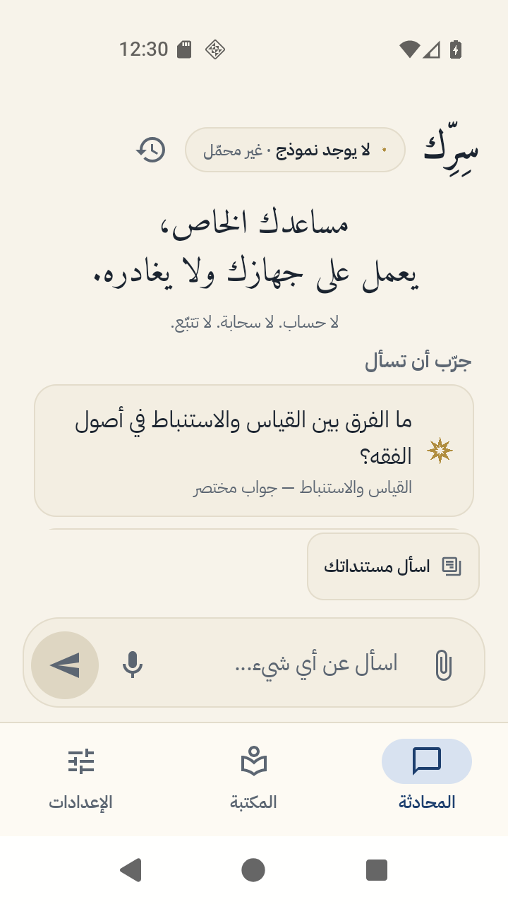
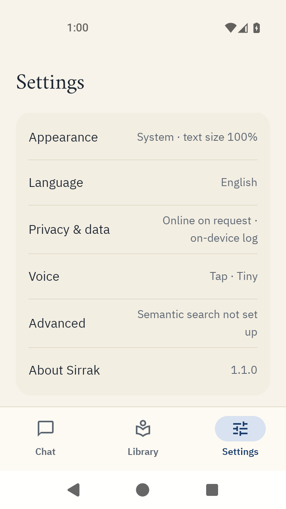

 

  

<h1 align="center">سِرِّك · Sirrak</h1>

  <strong>Private, Arabic-first AI assistant for Android. The model runs on your phone.</strong> 
  مساعد ذكاء اصطناعي عربي خاص يعمل على جهازك: محادثة وإملاء وإجابة من مستنداتك، دون اتصال.

  
  
  
  
  
  

  <b>English</b> ·
  <a href="README.ar.md">العربية</a> ·
  <a href="https://alshahia.github.io/sirrak/">Website</a> ·
  <a href="https://alshahia.github.io/sirrak/privacy/">Privacy</a> ·
  <a href="https://alshahia.github.io/sirrak/security/">Security</a> ·
  <a href="https://github.com/alshahia/sirrak/releases/latest">Download</a> ·
  <a href="docs/README.md">Docs</a>

---

Sirrak (Arabic for *your companion*) is a private assistant for Arabic and English that runs a real language
model on your phone. Chat, dictation, document grounding and model management all work offline. The only
network requests the app can make are ones you start: a model download, a Hugging Face catalogue search or
repository browse, or a bounded GGUF header probe — each is listed in the in-app network log. No account, no
cloud, no ads, no telemetry, no analytics. Apache-2.0 source.

It is built Arabic-first, not translated as an afterthought: a right-to-left layout designed from the start,
Amiri and IBM Plex Sans Arabic typography, Arabic and English dictation, and five hand-written theme packs
instead of a stock Material palette.

**Status:** the [repository](https://github.com/alshahia/sirrak) and the bilingual site are public, the
privacy and security policies are published in both languages, and the signed `1.0.0-rc2` APK is served from
[GitHub Releases](https://github.com/alshahia/sirrak/releases/latest). `1.1.0` is the current candidate (the UX
rework: three-segment Library, six-door Settings, an in-app Hugging Face doorway and a media shelf —
[docs/32](docs/32-ux-rework-build-record.md)). No release keystore is present in this checkout, so the
validated `1.1.0` artifact is the debug-signed universal APK recorded in [docs/27](docs/27-sirrak-launch-checklist.md)
P3.10; a signed release has to be cut where the keystore lives. F-Droid and Play are prepared but have no store
listing yet — see [Limits](#limits-honest).

## Why Sirrak

- **On-device by default.** Chat runs through a statically linked [llama.cpp](https://github.com/ggml-org/llama.cpp)
  engine on the CPU; conversations live in app-private storage.
- **Offline when you want.** Import a GGUF model and the app never needs the network again. An **offline-only**
  switch blocks every request and cancels a running download.
- **Arabic-first.** RTL layout, Arabic typography, Arabic dictation, Arabic document retrieval — tested with a
  24-case Arabic evaluation suite on every JVM test run.
- **Consistent Arabic terminology.** A Qiyas-reviewed glossary fixes the shipped wording: an AI model is **نموذج**
  (not طراز), prompts are **تعليمات**, and the vision projector is **ملحق الرؤية** — [docs/30](docs/30-arabic-terminology.md).
- **Honest licences.** A bundled licence and credits registry (23 entries, full texts offline) feeds
  Settings → About, [NOTICE](NOTICE) and a drift-tested [CycloneDX SBOM](sbom.cdx.json); every catalogue model
  shows its licence before download.
- **Small and inspectable.** 15 Gradle modules, typed UI slots, a dependency-ordered plugin runtime — a feature
  is one module plus one manifest line, not a fork of the shell.
- **No accounts, no ads, no tracking, no analytics.** There is no server to send anything to.

## What it does

| Surface | What you get |
|---|---|
| Chat | Streaming answers from a local GGUF model, multiple conversations with search/rename/delete, Markdown rendering, per-conversation system prompt and stop sequences, copy/regenerate/new-chat actions, token meter with measured tok/s |
| Dictation | On-device sherpa-onnx Whisper for Arabic and English; the recording strip shows a live timer with stop and cancel, and the transcript is appended to the composer, never sent automatically; audio never leaves the device |
| Documents | Import PDF, DOCX, EPUB, Markdown or text, index locally (embeddings + Arabic BM25 fused by RRF) and ask questions answered from numbered, explicitly untrusted sources with citation chips and excerpt sheets |
| Library | One device shelf with three segments: **models** (curated catalogue with device-aware fit verdicts — including a compact 2 GB tier —, GGUF import, per-model page), **downloads** (a persisted queue, one transfer at a time, resume/pause/cancel/retry after an app restart, background notification) and **media** |
| Media | Documents stay indexed for cited answers; images and audio live as shelf items; audio is transcribed on the device by Whisper into a text item (the audio never leaves the phone), with a keep-or-once retention choice and per-item agent-access control |
| Hugging Face | In-app search over the public GGUF repositories, a repo file list, and an 8–12 MB GGUF header probe that produces an honest device-fit verdict before any download starts; gated repos explain their gate instead of failing |
| Settings | Six doors with live summaries — appearance & reading, language (inline), privacy & network, voice, advanced, about — instead of one long scroll |
| Tuning | Temperature, top-p, top-k, repeat penalty, context size, streaming, chat-template choice, global and per-model prompts — all provable in one engine log line |
| Themes | Five hand-written theme packs with a live preview and a WCAG contrast gate: Girih & Ink, Lapis Night, Turquoise Dawn, Madder Dusk, Paper |
| Privacy | Per-call network log, offline-only switch, local AI-output reports you choose to export, and an honest state instead of a dead link where no store listing exists yet |

## Install

1. Open [Releases](https://github.com/alshahia/sirrak/releases/latest) and download the signed **libre** APK
   (~139 MiB, universal arm64-v8a + x86_64). GitHub Releases is the only download path; the Play build is a
   separate signed bundle whose closed testing has not started.
2. Install it on **Android 9+ (API 28)**. Android may ask you to allow installing from this source; the APK is
   signed with the project certificate (SHA-256 <code>4537ECEB9952AC9020EFFCEB8B50CB10AEB795772792D632CFC3D0B9F7106806</code>,
   verify with <code>apksigner verify --print-certs</code>).
3. On first run, choose a model in onboarding, or start with the built-in demo engine to see the interface.
4. No model is bundled: download one from the curated catalogue or import a GGUF file. After that, switch on
   **offline-only** and the app cannot reach the network at all.

**F-Droid:** the metadata is prepared, but the submission is not open — the pinned prebuilt sherpa-onnx
runtime still needs a source build in the F-Droid recipe (tracked in
[docs/27](docs/27-sirrak-launch-checklist.md)).
**Google Play:** the signed bundle is built and verified; closed testing has not started, so there is no
Play listing yet.

[Build from source](#build-from-source) if you prefer to compile it yourself.

## Screenshots

  
  
  
  

Arabic-first interface, light and dark, five packs, 48 dp touch targets and 200% text support.

## Privacy by construction

- **No telemetry, no analytics, no ads, no crash reporting service.** Nothing is sent anywhere unless you start
  a model download, a Hugging Face catalogue search/repository browse, or a GGUF header probe.
- **Network audit that cannot be hidden.** The app declares every endpoint in configuration and logs the calls
  that actually happened on the device; the log never leaves the phone.
- **Offline-only mode is enforced before a socket opens**, not as a UI hint.
- **Documents, chats, models and settings stay in app-private storage.** Share exports happen only through the
  Android chooser you invoke.
- **Policies (published, bilingual):** [privacy](https://alshahia.github.io/sirrak/privacy/) and
  [security](https://alshahia.github.io/sirrak/security/), also in the repository as [PRIVACY.md](PRIVACY.md)
  and [SECURITY.md](SECURITY.md).

## العربية

سِرِّك مساعد خاص بالعربية والإنجليزية يعمل على جهازك: المحادثة والإملاء والإجابة من مستنداتك وإدارة النماذج كلها
تعمل دون اتصال. لا يصدر التطبيق إلا الطلبات التي تبدأها أنت: تنزيل نموذج، أو البحث في فهرس Hugging Face
وفتح مستودع، أو فحص محدود (12 م.ب كحد أقصى) لترويسة GGUF — وكلها مسجّلة في سجل الشبكة داخل التطبيق. لا حسابات،
ولا سحابة، ولا إعلانات، ولا تتبّع، ولا قياسات. المصدر مفتوح بترخيص Apache-2.0.

**لماذا سِرِّك؟** المحرّك على الجهاز أولًا (llama.cpp على المعالج)، ووضع "دون اتصال فقط" يمنع كل طلب ويوقف أي
تنزيل جارٍ، والواجهة عربية أولًا من اليمين إلى اليسار بخطوط أميري وIBM Plex Sans Arabic، وخمس حزم ألوان
مكتوبة يدويًا، وسجل تراخيص صادق لكل مكوّن، ولا خادم تُرسل إليه محادثاتك.

**ما الذي يفعله؟** محادثة بثّية مع نموذج محلي مع سجل محادثات وبحث وإعادة تسمية وتصدير؛ إملاء عربي وإنجليزي عبر
sherpa-onnx Whisper على الجهاز؛ الإجابة من مستنداتك (PDF وDOCX وEPUB ونصوص) مع مراجع واقتباسات؛ ومكتبة واحدة
بثلاثة أقسام: النماذج (كتالوج منسّق بحكم توافق صريح مع الجهاز، واستيراد GGUF، وصفحة لكل نموذج)، والتنزيلات
(طابور محفوظ، تنزيل واحد في كل مرة، واستئناف بعد إغلاق التطبيق)، والوسائط (مستندات مفهرسة، وصور، وصوت يُفرَّغ
نصيًا على الجهاز، مع اختيار الإبقاء أو الاستخدام مرة واحدة وتحكّمك في وصول الوكيل). البحث في Hugging Face من
داخل التطبيق مع فحص ترويسة GGUF قبل التنزيل، والإعدادات ستة أبواب بملخصات حيّة بدل تمريرة واحدة طويلة، والخصوصية
بيدك: سجل شبكة لكل طلب، ومفتاح "دون اتصال فقط"، وبلاغات محلية لمخرجات الذكاء الاصطناعي تصدّرها أنت فقط إن أردت.

**التثبيت:** نزّل ملف APK الموقَّع من صفحة [الإصدارات](https://github.com/alshahia/sirrak/releases) على
أندرويد 9 أو أحدث. لا يوجد نموذج مضمَّن في التطبيق؛ اختر نموذجًا من الكتالوج أو استورد ملف GGUF، ثم فعّل وضع
عدم الاتصال. F-Droid قيد الإعداد وليس منشورًا بعد، وGoogle Play قيد الاختبار المغلق.

اقرأ المزيد في [README.ar.md](README.ar.md).

## Build from source

Requirements: JDK 21, Android SDK platform 36 + build-tools 36, Android NDK **27.2.12479018** and CMake 3.22.1
for the native engine, Gradle wrapper 8.10.2 (bundled). The llama.cpp source is vendored under
<code>third_party/llama.cpp</code> — no network fetch is needed for the native build.

~~~powershell
# point these at your own JDK 21 and Android SDK
$env:JAVA_HOME = '<path-to-jdk-21>'
$env:ANDROID_HOME = '<path-to-android-sdk>'
$env:ANDROID_SDK_ROOT = $env:ANDROID_HOME

# libre debug APK (libre = F-Droid/self-hosted default; play is the Play flavour)
.\gradlew :app:assembleLibreDebug

# 744 JVM tests across 10 modules (the same selection CI runs)
.\gradlew :app:testLibreDebugUnitTest testDebugUnitTest

# signed release APK + Play bundle (reads the git-ignored keystore.properties; unsigned without it)
.\gradlew assembleLibreRelease bundlePlayRelease

# quality gates
.\gradlew :app:lintLibreDebug
pwsh -File scripts/ui-regression.ps1     # 4-screen screenshot regression vs committed baselines
pwsh -File scripts/validate-store.ps1    # 79 checks: listing limits, graphics hashes, launch docs
pwsh -File scripts/release-check.ps1     # build + signatures + store assets + screenshots -> build/release-check.json
~~~

More detail: [CONTRIBUTING.md](CONTRIBUTING.md), [docs/05-architecture.md](docs/05-architecture.md) and
[docs/07-test-environment-emulator.md](docs/07-test-environment-emulator.md).

## Repository map

| Path | Contains |
|---|---|
| <code>app/</code> | application shell, composition manifest, host services, engine plugins, download service, settings/library/about plugins, assets |
| <code>core/runtime/</code> | <code>AppContext</code>, typed slots, config validation, service contracts, licence registry + SBOM builder |
| <code>core/design/</code> | theme packs + WCAG contrast gate, tokens, typography, shell, chat/settings components |
| <code>core/rag/</code> <code>core/speech/</code> <code>core/models/</code> <code>core/privacy/</code> | pure-JVM policy cores: retrieval, speech, model management, privacy |
| <code>feature/*</code> | chat, settings, voice, models, privacy plugins contributing through typed slots |
| <code>engine/llamacpp/</code> <code>engine/whisper/</code> | native llama.cpp engine; sherpa-onnx Whisper adapter |
| <code>docs/</code> | public product and build records (24 documents + index) |
| <code>store/</code> | Play/F-Droid listing copy, screenshots, generated graphics, store spec |
| <code>scripts/</code> | build/release/test/store/site quality scripts |
| <code>website/</code> | bilingual static site generated from data, deployed to GitHub Pages |

## Extending it without hardcoding

Everything a user can change is data, not code:

- **Features** are Gradle modules composed by [AppComposition.kt](app/src/main/java/app/sirrak/AppComposition.kt);
  order and enablement come from <code>app/src/main/assets/config/app.json</code> with no rebuild.
- **Cross-feature UI** goes through typed slots in [Slots.kt](core/runtime/src/main/java/app/sirrak/core/runtime/Slots.kt);
  a feature never imports another feature.
- **Theme packs** are one data object each in [ThemePacks.kt](core/design/src/main/java/app/sirrak/core/design/ThemePacks.kt)
  and the contrast gate re-checks every pack.
- **Copy** lives in the resource files; **models, prompts and demo content** are JSON assets; **store graphics**
  are rendered from [brand.json](store/graphics/brand.json); **the website** is rendered from
  [website/site.json](website/site.json).
- **Licences** are one registry entry: About, NOTICE and the SBOM all derive from it, and drift tests fail the
  build if they diverge.

The rules are written down in [CONTRIBUTING.md](CONTRIBUTING.md) and [docs/17-customization-council.md](docs/17-customization-council.md).

## Quality and evidence

| Gate | Result on <code>1.1.0</code> |
|---|---|
| JVM unit tests | **744 tests, 0 failures** across 10 modules |
| Arabic evaluation | **24/24** cases (normalisation, sentence splitting, BM25, negative controls) |
| Android lint | **0 errors**, 39 reviewed warnings (dependency/AGP version pins plus 3 transitive TLS warnings) |
| Screenshot regression | **4/4 screens, distance 0** against committed baselines |
| Store validator | **79/79 checks** (copy limits, graphics hashes, launch docs) |
| Release gate | [<code>scripts/release-check.ps1</code>](scripts/release-check.ps1) builds, verifies v2 signature + certificate, checks the AAB, validates store assets and runs the screenshot gate |
| SBOM | CycloneDX 1.5, 22 components + the app subject (23 licence-registry entries), drift-tested |
| Accessibility | 48 dp targets, 200% text, RTL mirroring, TalkBack labels, WCAG contrast gate |

## Limits (honest)

- **Performance** is measured on an emulator (API 36 x86_64), not a physical phone; arm64 builds are provided
  but not benchmarked here.
- The `1.1.0` candidate artifact is a universal **debug** APK (arm64-v8a + x86_64, ~213 MiB) because this
  checkout has no release keystore; the signed `1.0.0-rc2` release on GitHub remains the ~139 MiB build. No ABI
  splits yet, and release signing is **v2 only** (v3/v4 key rotation not configured).
- **Model quality varies.** The catalogue ships no bilingual vision model; Arabic vision questions are a known
  limitation. Small models can ignore citations; a deterministic fallback covers that.
- **Media and Hugging Face are V1.** Images are view-only; audio is transcribed on the device and the audio
  itself is not played from chat; a one-time media item is deleted when the app closes because chat cannot yet
  reference shelf media. Hugging Face rows show a repository's GGUF files, not per-file parameter counts or
  quantisation; an unprobed file stays `UNKNOWN` until you run the 12 MB header probe.
- **F-Droid is not published** — the prebuilt sherpa-onnx AAR needs a source build first. **Play is not
  published** — closed testing has not started.
- The policy pages are published in both languages, but no store listing exists yet, so the app shows an
  honest state where that URL is still missing.
- CI runs JVM tests, the Arabic eval and lint; device tests, screenshot regression and release building are
  local (they need an emulator or signing keys) — see [docs/27](docs/27-sirrak-launch-checklist.md).

## Documentation

- [docs/README.md](docs/README.md) — every public build record, indexed.
- [docs/26-sirrak-p3-polish-launch.md](docs/26-sirrak-p3-polish-launch.md) — launch candidate record.
- [docs/27-sirrak-launch-checklist.md](docs/27-sirrak-launch-checklist.md) — what is done and what is left.
- [docs/28-public-launch-council.md](docs/28-public-launch-council.md) — repository/site/SEO council decisions.
- [DESIGN.md](DESIGN.md) — the Girih & Ink design system.
- [PRODUCT.md](PRODUCT.md) — product scope and promises.

## Licence, credits and security

Sirrak is licensed under the [Apache License 2.0](LICENSE). Third-party components, fonts and models are listed
in [NOTICE](NOTICE); the full licence texts ship inside the app. Model weights are not bundled: each model is
downloaded or imported by you under its own licence.

Security issues: please use the [private advisory form](https://github.com/alshahia/sirrak/security/advisories/new),
never a public issue. See [SECURITY.md](SECURITY.md). Bugs and feature requests go to
[Issues](https://github.com/alshahia/sirrak/issues); contributing rules are in [CONTRIBUTING.md](CONTRIBUTING.md).

Sirrak is not affiliated with, endorsed by, or sponsored by any model provider. "llama.cpp", "Whisper",
"Qwen", "Llama", "Gemma" and other names are trademarks of their respective owners.
